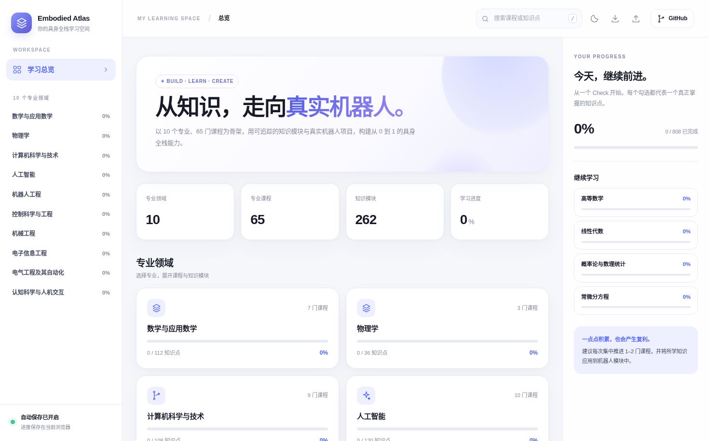
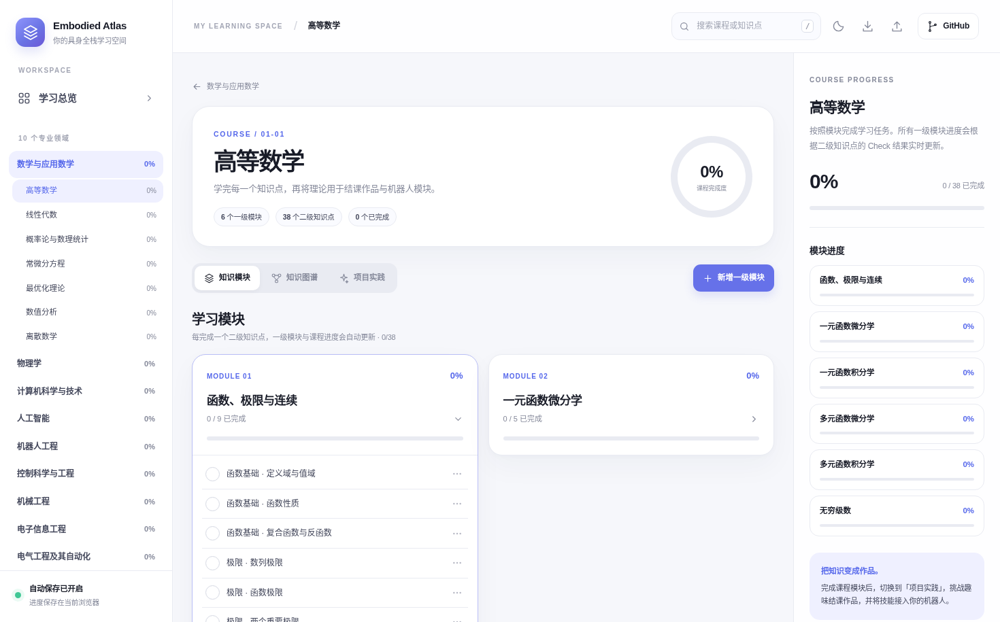
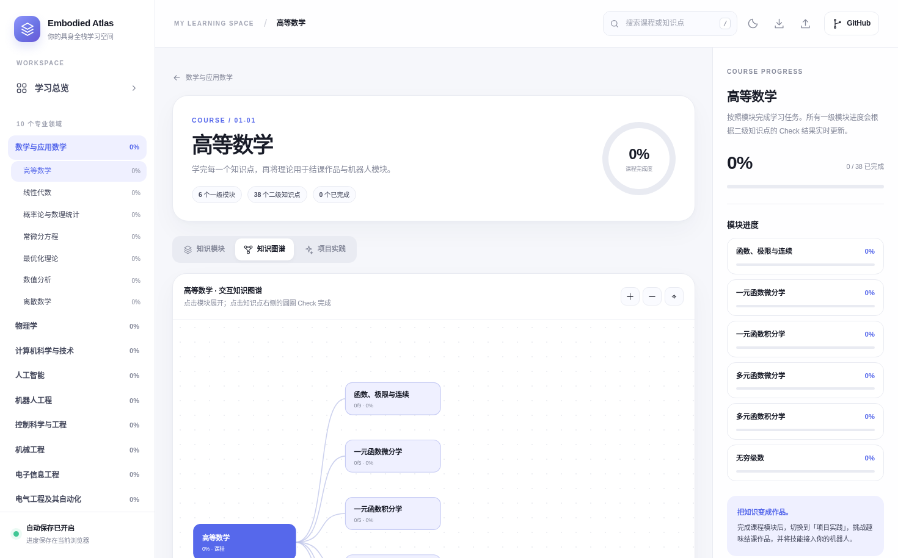

# Embodied Atlas · 具身智能全栈知识图谱

> 一套面向“从 0 到 1 设计、制造、编程和研究机器人”的个人学习操作系统。  
> **10 个专业 · 65 门课程 · 262 个一级知识模块 · 808 个二级知识点 · 130 个课程项目**

**[打开我的交互式知识图谱](https://YOUR-USERNAME.github.io/embodied-ai-fullstack-roadmap/)** · [学习顺序](roadmap/learning-order.md) · [课程与项目数据](data/courses.json) · [知识模块数据](data/course_topics.json) · [操作说明](roadmap/knowledge-progress-guide.md)



## 核心设计

每门课程采用固定的**四级导航结构**：

```text
专业（例如：数学与应用数学）
└── 专业课程（例如：高等数学） — 自动显示课程总进度
    ├── 一级知识模块：函数、极限与连续 — 自动显示模块进度
    │   ├── 二级知识点：定义域与值域  □
    │   ├── 二级知识点：函数性质      □
    │   └── ……
    ├── 一级知识模块：一元函数微分学
    │   ├── 二级知识点：导数与微分  □
    │   └── ……
    ├── 一级知识模块：一元函数积分学
    ├── 一级知识模块：多元函数微分学
    ├── 一级知识模块：多元函数积分学
    └── 一级知识模块：无穷级数
```

- **二级知识点勾选完成**：每个知识点只有“未完成 / 已完成”两种计入进度的状态。
- **一级知识模块自动汇总**：模块进度 = 已勾选知识点 / 该模块所有知识点。
- **课程、专业、全局自动汇总**：均基于该范围内的二级知识点数加权计算，而不是简单平均百分比。
- **模块和知识点可编辑**：在网页中新增、重命名或删除，不必写代码。
- **知识图谱视图**：课程 → 模块 → 知识点，支持缩放、拖动、展开和勾选。
- **每个知识点可记笔记并保存资源链接**：方便实际学习、复盘与做项目。
- **130 个项目保留**：每门课程 1 个趣味结课项目 + 1 个可用于真实机器人的模块项目，附 GitHub 参考仓库。
- **明暗主题 / 移动端适配 / JSON 备份**：无需注册，无需后端，无需框架或构建工具。





### 学习进度计算示例

如果“一元函数微分学”共有 5 个知识点，勾选完成 2 个，该模块显示 **40%**。如果整门“高等数学”有 38 个知识点，完成 2 个则课程显示 **约 5%**（四舍五入为整数）。这种计算不会因为某个模块知识点数量较多而失真。

## 专业课程目录

| 专业领域 | 课程数 | 课程与 GitHub 双项目说明 |
| --- | ---: | --- |
| 数学与应用数学 | 7 | [课程项目](courses/01-math.md) |
| 物理学 | 3 | [课程项目](courses/02-physics.md) |
| 计算机科学与技术 | 9 | [课程项目](courses/03-computer-science.md) |
| 人工智能 | 10 | [课程项目](courses/04-artificial-intelligence.md) |
| 机器人工程 | 9 | [课程项目](courses/05-robotics.md) |
| 控制科学与工程 | 6 | [课程项目](courses/06-control.md) |
| 机械工程 | 6 | [课程项目](courses/07-mechanical.md) |
| 电子信息工程 | 8 | [课程项目](courses/08-electronics.md) |
| 电气工程及其自动化 | 4 | [课程项目](courses/09-electrical.md) |
| 认知科学与人机交互 | 3 | [课程项目](courses/10-cognitive.md) |

知识点目录为可编辑的建议大纲，并非学校的官方培养方案。每门课程设置一个可独立展示的结课大项目和一个机器人系统可复用的模块项目；开源仓库是学习参考，不等于已经完成项目实现。

## 快速使用

### 1. 在本地运行

在 Windows 的 VSCode 终端进入仓库根目录：

```bash
python -m http.server 8000 --directory docs
```

浏览器打开 `http://localhost:8000`。如果已安装 Python，也可以直接双击 Windows 根目录里的 `run-local.bat`。

### 2. 部署到 GitHub Pages

创建仓库 `embodied-ai-fullstack-roadmap` 并上传全部文件；在 **Settings → Pages → Build and deployment** 中设置：

- Source: **Deploy from a branch**
- Branch: **main**
- Folder: **/docs**

保存后，站点地址通常为：`https://YOUR-USERNAME.github.io/embodied-ai-fullstack-roadmap/`。

### 3. 更新所有用户看到的默认知识树

修改 `data/course_topics.json` 后，在根目录运行：

```bash
python scripts/sync_graph.py
```

它会更新静态网页读取的 `docs/topics.js`；如果还修改了结课项目、机器人模块的名称与仓库链接，则编辑 `data/courses.json` 并运行相同命令。

### 4. 保存个人学习进度

网页勾选状态、笔记和自定义内容保存在**当前浏览器的 localStorage**，并不会自动上传 GitHub 或跨设备同步。建议在页面右上角定期点击“导出进度备份”保存 JSON；换电脑时点击“导入进度备份”。

**从 V4 升级：** 第一次打开 V5 时，会尝试读取同一浏览器、同一网站域名下的 V4 记录；也可以直接导入 V4 导出的 JSON 备份。V4 的“已掌握”变成“已勾选”；“学习中”和“未开始”都视为未勾选。

## 仓库结构

```text
embodied-ai-fullstack-roadmap/
├── README.md
├── docs/                        # 可直接用于 GitHub Pages 的网页
│   ├── index.html
│   ├── styles.css
│   ├── app.js
│   ├── data.js                   # 课程/项目自动生成文件
│   └── topics.js                 # 一级模块/二级知识点自动生成文件
├── data/
│   ├── courses.json              # 10 专业 65 课程及双项目
│   └── course_topics.json        # 262 模块 808 知识点
├── courses/                      # 课程与项目文字资料
├── scripts/
│   ├── sync_graph.py             # 更新网站内置数据
│   └── normalize_topics.py       # V4 旧树转两级知识模块的迁移工具
├── roadmap/                      # 学习顺序和使用教程
├── projects/                     # 独立结课项目报告模板
├── assets/                       # 网页截图
└── run-local.bat                  # Windows 一键启动
```

**注意：** `scripts/build_topics.py` 是原始知识点生成器（旧版目录），不要在正常更新时运行，否则可能覆盖你编辑好的知识模块。请使用 `scripts/sync_graph.py`。

## 面向机器人的长期主线

**第一代：** 树莓派移动机器人 → ROS 2、基础驱动、视觉跟随、语音交互。  
**第二代：** 自主设计移动操作平台 → CAD、PCB、嵌入式、导航、机械臂。  
**第三代：** 学习型自主机器人 → 模仿学习、强化学习、多模态决策、VLA。

所有课程项目应保留运行说明、代码、实验数据、结果指标、个人贡献与参考开源许可证。主知识图谱用于管理学习和汇总项目，重要项目可单独创建 GitHub 仓库并在此链接。
